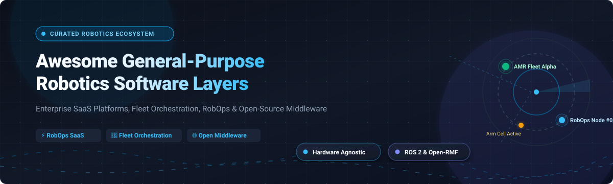

# Awesome General-Purpose Robotics Software Layers 🤖🚀

  
  
  
  
  
  

  <strong>Curated collection of General-Purpose Robotics Software Layers, RobOps platforms, robot fleet management software, ROS/ROS 2 orchestration engines, and hardware-agnostic control frameworks. 🦾🌐</strong>

  <em>Last updated: October 2026 📅</em>

---

General-purpose robotics software layers provide hardware-agnostic operating systems, middleware, fleet orchestration, task allocation, and skill abstraction—empowering autonomous mobile robots (AMRs), robotic arms, inspection drones, and industrial automated guided vehicles (AGVs) to execute variable missions without rewriting low-level control code for each proprietary hardware system. 🎯✨

---

## 📑 Table of Contents

- [📊 Sector Overview & Market Dynamics](#-sector-overview--market-dynamics)
- [☁️ SaaS & Hosted Platforms](#️-saas--hosted-platforms)
- [💻 Open-Source Projects](#-open-source-projects)
- [🏗️ Architecture & Stack Guide](#️-architecture--stack-guide)
- [🤝 Support](#-support)
- [📈 Star History](#-star-history)
- [🤝 How to Contribute](#-how-to-contribute)
- [⚠️ Disclaimer & Safety Considerations](#️-disclaimer--safety-considerations)

---

## 📊 Sector Overview & Market Dynamics

The global cloud robotics and robot fleet management software market is estimated at **$10–$14 billion (2025–2026)** and is projected to expand at a compound annual growth rate (CAGR) of over **22–25%** toward **$70+ billion by the mid-2030s**. 📈

The sector exhibits a **hybrid market concentration**:
- 🏢 **Highly Concentrated Cloud & Compute Layer**: Foundational AI models, GPU simulation, and hyperscaler infrastructure are heavily concentrated among top cloud providers (AWS, Microsoft Azure, Google Cloud, NVIDIA).
- 🧩 **Moderately to Highly Fragmented Application & Orchestration Layer**: Multi-vendor fleet orchestration, robot operations (RobOps), and warehouse/facility integration remain fragmented across independent software vendors and vertical specialists due to heterogeneous robot hardware protocols, diverse industrial field buses, and localized data sovereignty regulations.

---

## ☁️ SaaS & Hosted Platforms

The table below lists leading commercial SaaS and hosted platforms for robot operations, multi-robot fleet orchestration, telemetry ingestion, and autonomous system management. 🚀

Entries are **sorted in descending order by company size** (market capitalization, recent acquisition valuation, or total venture funding capital). 💼

| Platform | Company Size (Valuation / Revenue / Raised) | Starting Tier Pricing | Free Tier / Trial Limit | Key Focus & Capabilities |
| :--- | :--- | :--- | :--- | :--- |
| [**Rocos**](https://www.rocos.io/) *(DroneDeploy)* 🌐 | **$845M** acquisition valuation by Procore (DroneDeploy ~$78M TTM revenue; $142M+ raised) | **Custom quote** (scaled per robot/month; enterprise quotes via DroneDeploy) | **14-day free trial** (enterprise evaluation via demo/PoC) | Multi-vendor ground robot (Spot, AMRs) and aerial drone fleet operations, mission scheduling, and reality capture. 🚁 |
| [**Apex.AI**](https://www.apex.ai/) 🚗 | **$100M–$250M** est. valuation ($74M+ raised; ~$8.5M–$17M est. ARR) | **Custom annual enterprise license** (Apex.Grace & Apex.Ida SDK seat tiers) | **30-day proof-of-concept / evaluation license** (available upon sales consultation) | Production automotive- and safety-certified (ISO 26262 ASIL D) operating middleware built on ROS 2. 🛡️ |
| [**SVT Robotics**](https://svtrobotics.com/) 🏭 | **$100M–$250M** est. valuation ($31M raised; $10M–$50M est. revenue) | **Custom annual subscription** (priced per integrated system / warehouse site connector) | **30-day enterprise evaluation / PoC sandbox** (pre-deployment integration environment) | SOFTBOT platform providing no-code interoperability connectors between warehouse AMRs, WMS/ERP, and automated systems. 📦 |
| [**Foxglove**](https://foxglove.dev/) 📊 | **~$58.7M** total venture raised ($40M Series B in late 2025; backed by Bessemer) | **$20 / month** (Pro plan baseline with developer seats; usage-based scaling) | **Free plan forever** (capped at 10 GB cloud storage, 100 GB/month bandwidth, 100 GB/month indexing, 1 hr/month query, unlimited free basic seats) | Robotics data platform and visualization interface for ROS 1, ROS 2, and custom telemetry data streams. 📈 |
| [**Formant**](https://formant.io/) 📡 | **$45M** total venture raised (backed by BMW i Ventures, Intel Capital; ~$5M–$7M est. ARR) | **~$250 / robot / month** (enterprise contract base rate depending on bandwidth and fleet scale) | **Free developer account** (limited to 1 connected robot for basic telemetry & teleop; 14-day enterprise trial on request) | Cloud RobOps platform for robot fleet telemetry, real-time video teleoperation, incident response, and data pipelines. 🕹️ |
| [**InOrbit**](https://www.inorbit.ai/) 🛰️ | **$37M** post-money est. valuation ($12.75M raised; ~$1.7M est. ARR) | **$50–$100 / active robot / month** (Standard Edition pay-as-you-go based on Monthly Active Robots) | **Free Edition forever** (unlimited robots for core observability, live map telemetry tracking, and basic diagnostics) | Vendor-neutral RobOps platform featuring real-time fleet observability, mission dispatch, and incident intervention. 🧭 |
| [**MOV.AI**](https://mov.ai/) ⚙️ | **$25M–$50M** est. valuation ($17M raised; backed by BOWE GROUP) | **Custom recurring license** (priced per AMR device and development seat) | **30-day developer evaluation license** (includes Flow visual programming environment and AMR simulator) | Industrial AMR software engine with visual dataflow programming, cyber-security hardening, and navigation integration. 🧩 |
| [**Cogniteam Nimbus**](https://www.cogniteam.com/) ☁️ | **$10M–$25M** est. valuation ($9.8M raised; ~$1M–$7M est. revenue) | **Custom tiered SaaS** (cloud compute workspace consumption + per-robot connection fees) | **Free trial available** (sign up at app.cognimbus.com with free cloud credits for device onboarding and simulation) | Cloud operating system for rapid robot fleet deployment, autonomous task coordination, and Dockerized ROS package delivery. 🐳 |
| [**Freedom Robotics**](https://www.freedomrobotics.com/) 🎮 | **$6.6M** total venture raised (backed by Initialized Capital & Toyota AI Ventures) | **Usage-based monthly fee per active robot** (Standard, Plus, and Pro tiers) | **14-day free trial** (full access to device telemetry, remote web teleop, and cloud logging) | Remote fleet management and teleoperation platform supporting OTA software updates and real-time sensor visualization. 🔄 |
| [**Polymath Robotics**](https://polymathrobotics.com/) 🚜 | **$1.7M** est. ARR (backed by Y Combinator S22 & Samsara Ventures) | **Custom usage / fleet license** (annual contract scaled per off-highway autonomous vehicle) | **30-day sandbox demo trial** (teleoperation & safety perception testing in simulated environment) | Hardware-agnostic autonomous driving and safety software layer for off-highway, agricultural, and industrial utility vehicles. 🌾 |

---

## 💻 Open-Source Projects

The table below catalogs premier open-source robotics middlewares, fleet management engines, navigation packages, and visualization platforms. 🛠️

Entries are **sorted in descending order by GitHub stargazers count**. Each badge links directly to the repository's stargazers page. ⭐

| Repository | Stars | License | Description & Architectural Scope |
| :--- | :---: | :---: | :--- |
| [**Autoware**](https://github.com/autowarefoundation/autoware) 🚙 |  | Apache-2.0 | Complete open-source autonomous driving software stack built on ROS 2, covering 3D perception, NDT localization, behavior planning, and control. |
| [**Cartographer**](https://github.com/cartographer-project/cartographer) 🗺️ |  | Apache-2.0 | Real-time simultaneous localization and mapping (SLAM) system in 2D and 3D across diverse sensor configurations with ROS/ROS 2 integration. |
| [**Pixi**](https://github.com/prefix-dev/pixi) 📦 |  | BSD-3-Clause | Fast, reproducible package management workflow tool built on Conda ecosystem, widely adopted for isolated ROS/ROS 2 multi-platform dependency setups. |
| [**PlotJuggler**](https://github.com/PlotJuggler/PlotJuggler) 📈 |  | MPL-2.0 | Fast time-series data visualization and logging analysis tool for robotics, with native support for ROS/ROS 2 bags, CSV, MQTT, and custom plugins. |
| [**ROS 2**](https://github.com/ros2/ros2) 🤖 |  | Apache-2.0 | The industry-standard open-source robotics middleware providing DDS-based pub/sub, hardware abstraction, real-time executors, and lifecycle management. |
| [**Navigation2 (Nav2)**](https://github.com/ros-navigation/navigation2) 🧭 |  | Apache-2.0 | Production-grade mobile robot navigation stack for ROS 2 utilizing behavior trees, costmaps, dynamic obstacle avoidance, and multi-robot navigation. |
| [**BehaviorTree.CPP**](https://github.com/BehaviorTree/BehaviorTree.CPP) 🌳 |  | MIT | C++ library for developing flexible and hierarchical Behavior Trees, serving as the decision-making brain in Nav2 and industrial robot task executives. |
| [**RealSense ROS**](https://github.com/realsenseai/realsense-ros) 📷 |  | Apache-2.0 | Official ROS/ROS 2 wrapper for Intel RealSense depth cameras (D400 series, L515), providing point clouds and aligned depth streams for perception. |
| [**Zenoh**](https://github.com/eclipse-zenoh/zenoh) ⚡ |  | Apache-2.0 / EPL-2.0 | Ultra-low-overhead, zero-copy pub/sub/query protocol uniting edge, cloud, and embedded microcontrollers; primary modern DDS router for ROS 2 multi-fleet telemetry. |
| [**Grid Map**](https://github.com/ANYbotics/grid_map) 📐 |  | BSD-3-Clause | Multi-layered 2.5D grid mapping library designed for mobile and legged robot rough-terrain navigation, traversability estimation, and elevation mapping. |
| [**KISS-ICP**](https://github.com/PRBonn/kiss-icp) 🔍 |  | MIT | Fast, accurate, and lightweight LiDAR odometry and point cloud registration pipeline with ROS/ROS 2 interfaces. |
| [**MoveIt**](https://github.com/moveit/moveit) 🦾 |  | BSD-3-Clause | De facto motion planning and manipulation framework for ROS, providing kinematics, collision detection, trajectory generation, and 3D perception. |
| [**MoveIt 2**](https://github.com/moveit/moveit2) 🦾 |  | BSD-3-Clause | The official ROS 2 version of MoveIt, architected with deterministic execution, real-time servoing, hybrid planning, and multi-arm coordination. |
| [**Gazebo Sim**](https://github.com/gazebosim/gz-sim) 🎮 |  | Apache-2.0 | High-fidelity multi-robot physics simulation platform featuring modular physics engines (ODE, Bullet, DART), sensor simulation, and ROS 2 bridges. |
| [**Fuse**](https://github.com/locusrobotics/fuse) 🔗 |  | BSD-3-Clause | Non-linear factor graph sensor fusion library developed by Locus Robotics for robust state estimation and localization in autonomous mobile fleets. |
| [**Open-RMF Demos**](https://github.com/open-rmf/rmf_demos) 🏢 |  | Apache-2.0 | Reference implementations and demonstration packages for Open-RMF showing multi-fleet traffic conflict deconfliction and elevator/door integration. |
| [**Micro-ROS Setup**](https://github.com/micro-ROS/micro_ros_setup) 💡 |  | Apache-2.0 | Embedded ROS 2 stack running directly on microcontrollers (ESP32, STM32, Teensy, Raspberry Pi Pico) over Micro-XRCE-DDS. |
| [**RViz2**](https://github.com/ros2/rviz) 👓 |  | BSD-3-Clause | 3D visualization tool for ROS 2 that displays sensor point clouds, robot models (URDF), TF coordinate frames, and navigation trajectories. |
| [**Open-RMF Core**](https://github.com/open-rmf/rmf) 🚦 |  | Apache-2.0 | Open-source Robotics Middleware Framework for heterogeneous multi-fleet orchestration, space sharing, and automated facility integration. |
| [**Generate Parameter Library**](https://github.com/PickNikRobotics/generate_parameter_library) 📝 |  | BSD-3-Clause | Declarative C++ / Python ROS 2 parameter validation library with compile-time type safety, widely adopted across modern ROS 2 drivers. |
| [**TurtleBot 4**](https://github.com/turtlebot/turtlebot4) 🐢 |  | Apache-2.0 | Open-source reference robotics development platform built on iRobot Create 3 and Raspberry Pi 4 running Ubuntu and ROS 2. |
| [**Colcon Core**](https://github.com/colcon/colcon-core) 🔨 |  | Apache-2.0 | Universal command-line build tool designed to discover, build, test, and install sets of software packages across multiple build types. |
| [**Open-RMF ROS 2**](https://github.com/open-rmf/rmf_ros2) 🔌 |  | Apache-2.0 | Core ROS 2 communication nodes, scheduling adapters, and task dispatcher modules for Open-RMF fleet coordination. |
| [**Foxglove Studio**](https://github.com/foxglove/studio) 🖥️ |  | MPL-2.0 *(Archived)* | Original open-source desktop visualization app for ROS 1 and ROS 2 messages, custom layout authoring, and MCAP recording inspection. |
| [**RQt**](https://github.com/ros-visualization/rqt) 🎛️ |  | BSD-3-Clause | Extensible Qt-based graphical user interface framework for inspecting ROS 2 topics, service callers, message publishers, and node graphs. |
| [**Open-RMF Traffic**](https://github.com/open-rmf/rmf_traffic) 🚥 |  | Apache-2.0 | Mathematical package that models spatial-temporal robot trajectories, conflict resolution, and schedule negotiation across mixed robot fleets. |

---

## 🏗️ Architecture & Stack Guide

When architecting a production general-purpose robotics software layer, engineering teams combine components across the following tiers:

1. **Embedded & Real-Time Driver Tier** ⚡: [Micro-ROS](https://github.com/micro-ROS/micro_ros_setup) and hardware abstraction controllers running on microcontrollers and embedded compute.
2. **Middleware & Inter-Process Communication Tier** 🌐: [ROS 2](https://github.com/ros2/ros2) DDS middleware or [Eclipse Zenoh](https://github.com/eclipse-zenoh/zenoh) for edge-to-cloud telemetry and multi-robot bridges.
3. **Autonomy, Mapping & Navigation Tier** 🧭: [Nav2](https://github.com/ros-navigation/navigation2), [BehaviorTree.CPP](https://github.com/BehaviorTree/BehaviorTree.CPP), [Cartographer](https://github.com/cartographer-project/cartographer), [KISS-ICP](https://github.com/PRBonn/kiss-icp), and [MoveIt 2](https://github.com/moveit/moveit2).
4. **Fleet Orchestration & Facility Integration Tier** 🏭: [Open-RMF](https://github.com/open-rmf/rmf) for open multi-fleet coordination, or commercial cloud solutions like [InOrbit](https://www.inorbit.ai/), [Formant](https://formant.io/), or [SVT Robotics](https://svtrobotics.com/).
5. **Observability, RobOps & Teleoperation Tier** 🔭: [Foxglove](https://foxglove.dev/), [PlotJuggler](https://github.com/PlotJuggler/PlotJuggler), and [Freedom Robotics](https://www.freedomrobotics.com/).
6. **Simulation & Digital Twin Tier** 🧪: [Gazebo Sim](https://github.com/gazebosim/gz-sim) for continuous integration and safety validation before hardware deployment.

---

## 🤝 Support

Thank you for exploring this curated repository! If you find this resource helpful for your robotics research, fleet deployments, or RobOps architecture, please consider showing your support:

- ⭐ **Star this repository** to help others discover it on GitHub.
- 🍴 **Fork and contribute** new open-source software layers or RobOps tools.
- 📢 **Share with colleagues** in the robotics, AMR, and ROS developer communities.
- ☕ **Buy me a coffee / Sponsor**: If you'd like to support continued maintenance and curation of open-source robotics resources, you can sponsor through the [GitHub Sponsors Dashboard](https://github.com/sponsors/ishandutta2007).

Your support is deeply appreciated! 💖🙏

---

## 📈 Star History

---

## 🤝 How to Contribute

Contributions are welcome! To contribute to this curated ecosystem: 💡

1. Fork this repository.
2. Create a new branch: `git checkout -b feature/add-software-layer`.
3. Add the project or platform to the appropriate section:
   - For **SaaS platforms**, provide the official URL, current pricing information, free tier/trial limits, and company size/funding.
   - For **Open-source projects**, provide the GitHub link, official star badge (`style=social&color=white`) linked to `/stargazers`, license, and an architectural summary. Ensure projects are sorted descending by star count.
4. Submit a Pull Request with a clear description of the project and why it belongs in the general-purpose robotics layer.

---

## ⚠️ Disclaimer & Safety Considerations

- This list is **community-curated** for informational purposes and does not represent an endorsement. 📋
- Physical robotics operations involve kinetic risks. Industrial deployments must comply with relevant safety standards (e.g., ISO 10218, ISO/TS 15066 for collaborative robots, ANSI/RIA R15.06, and ISO 3691-4 for AGVs/AMRs). 🦺
- Open-source middleware (like standard ROS 2) is designed for general development; safety-critical applications requiring automotive or functional safety compliance may require certified runtime platforms (such as [Apex.AI](https://www.apex.ai/)'s Apex.Grace). 🛡️
- Ensure secure DDS network configuration, TLS encryption, and role-based access control when exposing robot fleet telemetry to external cloud endpoints. 🔒
